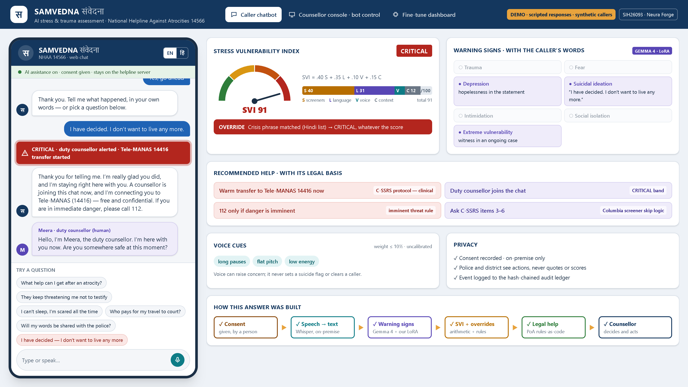
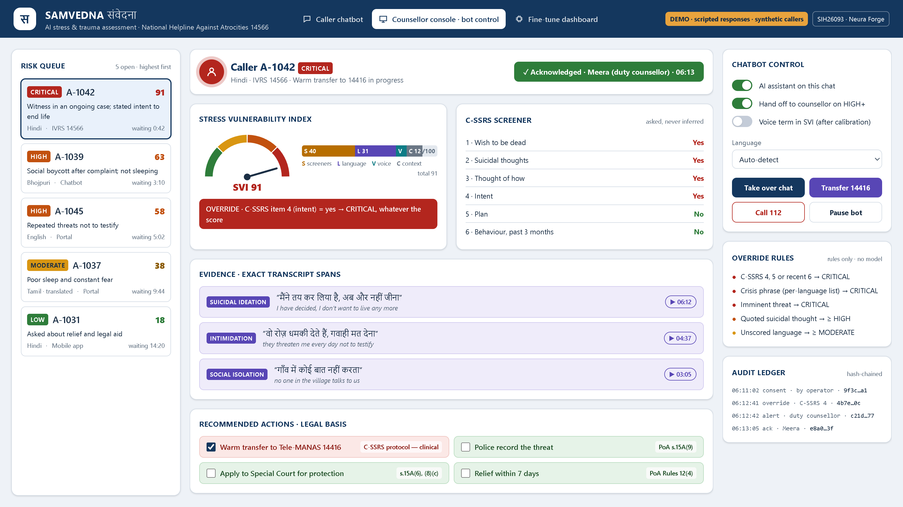
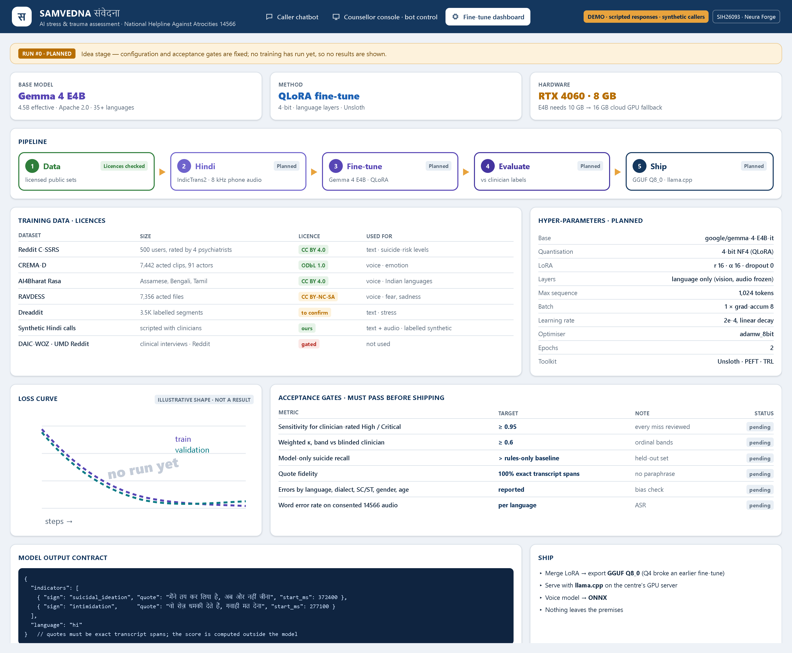

# SAMVEDNA · संवेदना

**AI-based real-time stress and trauma assessment for callers to the National Helpline Against Atrocities (NHAA 14566).**

Smart India Hackathon 2026 · Problem statement **SIH26093** (Ministry of Social Justice & Empowerment) · Team **Neura Forge** · Team ID 159009

- Demo video: [YouTube](https://youtu.be/MZ6oc7wpWLc) · [Google Drive](https://drive.google.com/file/d/1Tn6LDtHOuSVerv-aCWPUbzYjzYCg7rDc/view?usp=sharing)
- Idea deck: [`docs/NeuraForge_SIH26093_Idea_Submission.pdf`](docs/NeuraForge_SIH26093_Idea_Submission.pdf)
- Plan for the next phase: [`NEXT_PHASE.md`](NEXT_PHASE.md)

> **Status: idea stage.** This repository contains the **prototype UI** only. Every chatbot answer is scripted in advance, every caller is synthetic, and the Gemma 4 model has **not been trained yet**. [`NEXT_PHASE.md`](NEXT_PHASE.md) is the plan for building the real pipeline.

---

## What SAMVEDNA does

In one call, on the helpline's own server:

1. **Connect.** The same module sits behind the 14566 IVRS, the Integrated Portal, the chatbot and the mobile app. A person asks for consent in the caller's language. If the caller declines, no AI runs and the operator still screens them.
2. **Listen.** Whisper converts speech to text. openSMILE eGeMAPS measures voice cues: pauses, pitch variation, jitter, shimmer and loudness.
3. **Understand.** Gemma 4 E4B, to be fine-tuned by us, flags seven warning signs: trauma, fear, depression, suicidal ideation, intimidation, social isolation and extreme vulnerability. Each flag is backed by an exact quote from the transcript.
4. **Score.** The Stress Vulnerability Index (SVI) is `0.40·S + 0.35·L + 0.10·V + 0.15·C`, where S is short screeners asked in the call (PHQ-2, GAD-2, C-SSRS), L is the language model, V is voice and C is context. The score is banded Low / Moderate / High / Critical. Fixed rules, not the AI, force **Critical** on suicide intent, a plan, a recent attempt, a crisis phrase or an imminent threat.
5. **Advise.** Rules-as-code recommendations each name their legal basis: SC/ST (PoA) Act s.15A, PoA Rules 11 and 12(4), LSA Act s.12(a) and NALSA 15100, and Tele-MANAS 14416.
6. **Respond.** Callers go into a risk-ordered queue for the counsellor desk. A Critical alert is acknowledged by name, and every step goes into a hash-chained audit ledger. Police and district officers see only the action needed, never the caller's words or score.

## The prototype UI

| Caller chatbot | Counsellor console · bot control | Fine-tune dashboard |
|---|---|---|
|  |  |  |

- **Caller chatbot** (`#chat`): consent first, then six prepared questions in English or Hindi. Beside the chat, a "what the system sees" panel shows the SVI gauge, the warning signs with the caller's words, the recommended help and its legal basis, and the voice cues.
- **Counsellor console** (`#console`): the risk queue, C-SSRS answers, evidence with timestamps, an Acknowledge Critical button, bot controls (AI on/off, take over, transfer to 14416, call 112), the override rules and the audit ledger.
- **Fine-tune dashboard** (`#finetune`): the planned Gemma 4 E4B QLoRA run, the dataset licences, the hyper-parameters and the acceptance gates. Nothing has been run yet.

### Run it

Needs Node.js 20 or newer.

```bash
cd demo-ui
npm install
npm run dev          # http://localhost:5193
```

### Demo links

Each `?play=` link plays a scripted conversation automatically, which is useful for recording and screenshots:

| Scene | URL |
|---|---|
| Rights and help | `http://localhost:5193/#chat?play=help` |
| Threats not to testify | `http://localhost:5193/#chat?play=threat` |
| Can't sleep, scared | `http://localhost:5193/#chat?play=sleep` |
| Court travel costs (Hindi) | `http://localhost:5193/#chat?play=travel&lang=hi` |
| "Will police see my words?" | `http://localhost:5193/#chat?play=privacy` |
| Suicidal statement (Hindi) | `http://localhost:5193/#chat?play=crisis&lang=hi` |
| Counsellor console | `http://localhost:5193/#console` |
| Fine-tune dashboard | `http://localhost:5193/#finetune` |

Add `&instant` to skip the typing animation, or `&solo` to show only the phone. `demo-ui/snap.py` and `demo-ui/snap_qa.py` take screenshots of a running dev server with headless Chrome.

### Code map

| File | What it holds |
|---|---|
| `demo-ui/src/data.ts` | All scripted conversations, scores, warning signs, legal citations, and the synthetic console queue |
| `demo-ui/src/Chat.tsx` | Caller chatbot and the analysis panel |
| `demo-ui/src/Console.tsx` | Counsellor console and bot controls |
| `demo-ui/src/FineTune.tsx` | Fine-tune dashboard (planned run and acceptance gates) |
| `demo-ui/src/ui.tsx` | SVI gauge, stacked score bar, band chips |

Stack: React 19 · TypeScript · Tailwind CSS 4 · Vite.

---

## Safety note

SAMVEDNA is a research prototype, not a clinical tool. No real caller data is used or stored here. If you or someone you know is struggling, call **Tele-MANAS on 14416** (free, confidential, 24×7). In an emergency, call **112**.
